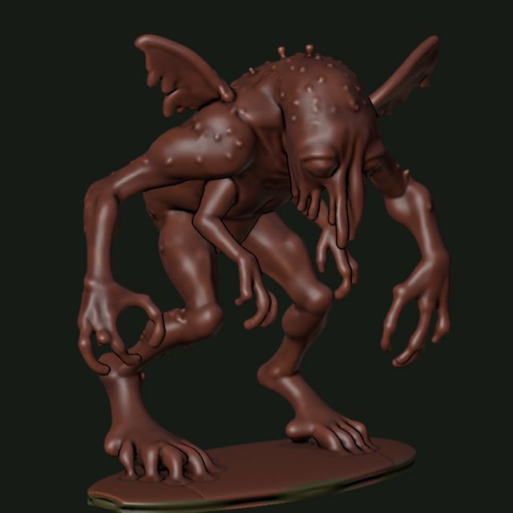

# Brundlefly figurine: printing instructions

This folder holds a printable 3D model of Brundlefly and the scripts that build it.
The shape comes from the sculpt reference image, `assets/brand/kit/lair/mascot-sculpt-reference.png`.



## How the model is made

1. An image-to-3D model reads the sculpt reference image and returns a base mesh. That mesh is `source/hunyuan3d-shape.glb`.
2. `build_from_mesh.py` turns the base mesh into a print model in Blender:
   - It removes the bristle spikes.
   - It grows thin parts to a 2.0 mm minimum.
   - It adds the base.
3. `export_model.py` writes the print files. `validate.ts` checks them.

`assets/prompts/figurine.json` records the generator, the date, and the settings.
Read the licence note in that file before you sell prints of this mesh.

## Files

| File | Use |
| --- | --- |
| `brundlefly-80mm.stl` | Print file, 80 mm tall. Send this file first. |
| `brundlefly-100mm.stl` | The same model at 100 mm. Every thin part is 25 percent thicker. |
| `brundlefly.blend` | Editable master. One Blender unit is one millimetre. |
| `brundlefly-preview.glb` | Preview of the print model, with the base. |
| `brundlefly-web.glb` | Model for the website: no base, bristles kept, thin parts not thickened. |
| `source/hunyuan3d-shape.glb` | The generated base mesh, unchanged. |
| `validation-report.json` | Output of `validate.ts` for the two STL files. |
| `previews/` | Front, side, back, three-quarter, and top renders of the print model, and one of the website model. |

## Dimensions

All values are millimetres. They come from `validation-report.json`.

| File | Width (X) | Depth (Y) | Height (Z) | Volume | Triangles |
| --- | --- | --- | --- | --- | --- |
| `brundlefly-80mm.stl` | 74.03 | 50.31 | 80.00 | 30.27 cm³ | 200,000 |
| `brundlefly-100mm.stl` | 92.53 | 62.89 | 100.00 | 59.12 cm³ | 200,000 |

Height runs from the underside of the base to the highest point of the head.
The base is about 3 mm thick at 80 mm. The underside is flat.

## Material

- First choice: flexible TPU, Shore 95A, FDM. Thin claws and wing edges bend in TPU. They snap in rigid plastic.
- A squeezable feel is not a goal. The model is one solid shell.
- Alternative: PLA or PETG. The print is easier, but claws and fingers break more easily.
- Alternative: resin. It gives the best surface detail at this size. Standard resin is brittle, so ask for a tough resin.
- Colour: one colour. Rust or black fit the palette in `docs/arch/brand.md`.

## Print orientation and supports

- Print upright, with the flat base on the bed.
- This pose needs supports. With a 45 degree threshold, the slicer used 20.2 cm³ of support for 17.1 cm³ of model.
- `validation-report.json` lists the points where material starts in mid-air (`mid_air_islands_mm`): 44 at 80 mm.
- The largest groups are the fingers and claws of the two long-arm hands, the two small-arm hands, and the hanging mouthparts.
- The head, the belly, and the wings overhang by more than 45 degrees. The slicer supports them.
- Use tree or organic supports. They touch less surface than grid supports.

## Slicer settings

Sliced values come from PrusaSlicer 2.9.7 with a generic 0.4 mm FDM profile. They are in `validation-report.json`.

| Setting | Value | Source |
| --- | --- | --- |
| Layer height | 0.2 mm | Sliced |
| Nozzle | 0.4 mm | Sliced |
| Walls | 3 | Sliced |
| Infill | 15 percent gyroid | Sliced |
| Filament without supports | 17.1 cm³, 2 h 45 min | Sliced |
| Filament with supports at 45 degrees | 37.4 cm³, 4 h 55 min | Sliced |
| Support filament | 20.2 cm³ | Sliced, by difference |
| Layer height for more detail | 0.12 to 0.16 mm | Estimate |
| TPU nozzle temperature | 220 to 235 °C | Estimate |
| TPU print speed | 20 to 30 mm/s | Estimate |
| Support Z gap for TPU | 0.20 to 0.25 mm | Estimate |
| Brim | 3 to 5 mm | Estimate |

No TPU printer profile was tested. A real TPU print has not been made.

## Minimum feature sizes

`build_from_mesh.py` grows every part that is thinner than 2.0 mm, by up to 0.7 mm on each side.

The voxel thickness check found these thin regions in `brundlefly-80mm.stl`:

- Thinner than 1.5 mm: 12.9 mm³ in total, in spots of 2.4 mm³ or less. They are stubs left by removed bristles and a few claw tips.
- Thinner than 2.5 mm: the two wings, the small arms, the mouthparts, and the fingers. They are 2.0 mm by design.
- The check uses 0.25 mm voxels. Read each limit with a tolerance of 0.25 mm.

For a stronger print, use `brundlefly-100mm.stl`. Its thin parts are 2.5 mm.

## Likely failure points

- Fingers, claws, and the small arms. They are 2.0 mm thick, and supports attach near them.
- The hanging mouthparts. They are thin and they start in mid-air.
- Support scars under the hands, the chin, and the belly. TPU supports are hard to remove cleanly.
- Stringing between the fingers and between the arms and the body.
- The wings. They are 2.0 mm thick and they overhang.

## Checks that ran

`node validate.ts` ran these checks on both STL files after a new import:

- Non-manifold edges, boundary edges, degenerate faces, loose vertices: zero.
- Shells: one. Volume: positive. Self-intersecting face pairs: zero.
- Height: 80.00 mm and 100.00 mm.
- Blender 3D Print Toolbox, check all: zero non-manifold edges, zero intersecting faces, one shell.
- The toolbox also reports 3,852 thin faces and 22,947 overhang faces at 80 mm. Its thin test fires on every convex edge, so the voxel check is the thickness result. The overhang count agrees with the need for supports.
- Mid-air start points: 44 at 80 mm.
- Voxel thickness check at 0.25 mm pitch.
- Stability: the centre of mass is 15.0 mm inside the footprint edge. The solid model tips at about 20 degrees.
- PrusaSlicer slice with supports and without supports.

## Checks the printer must confirm

These checks did not run:

- A print on a real machine, in TPU or in any other material.
- The printer's own minimum wall and minimum feature limits.
- Support removal on TPU without damage to the fingers and mouthparts.
- Stability of the printed figure on its base.
- Shore hardness and colour of the stocked filament.

Automated mesh checks are not a print-service approval.

## Bristles

The generated mesh had bristles as thin spikes. The print model removes them, because they are thinner than a nozzle.
Small bumps stay where the thicker bristles were. The model has no holes for bristles.

To add a real fibre after printing:

1. Push a pin or a hot needle 2 to 3 mm into the surface. The bumps are good places.
2. Cut a stiff fibre 6 to 10 mm long. Brush bristle or 0.3 mm nylon line are good choices.
3. Dip the end in flexible cyanoacrylate glue and push it into the hole.
4. Let the glue cure before you handle the figure.

These steps are untested on a printed part.
`build_from_mesh.py --dimples` adds pilot dimples and writes `bristle-map.json`, if you want marked positions.

## Differences from the brand artwork

- The figure stands on an integrated base. Soft TPU on two thin legs does not stand without one.
- One material prints no colour. The print shows shape only.
- The generator made the mesh from one image. The back and the far side are its estimate.
- Fingers, claws, wings, and mouthparts are thicker than in the artwork.

## Website model

`brundlefly-web.glb` follows the contract that the site loader expects.

- glTF 2.0 binary, metres, Y up, face toward +Z. The soles are at height zero.
- One root node, `Brundlefly`, with a scale of 0.001.
- `Brundlefly-body`: 80,000 triangles, vertex colours in `COLOR_0`, material `Brundlefly-skin`, single sided, roughness 0.42.
- The vertex colours carry baked shading and mottled tissue. The generated mesh has no texture, so the model has no chitin or eye colours.
- `anchor-face`: an empty node at the front of the face.
- No skeleton, no animation, no base, no compression extension. The site build stops if the file is larger than 4 MiB.

## Rebuild

Blender 5.3 as a Flatpak, PrusaSlicer as a Flatpak, Node 24, and `uv` are necessary. Use absolute paths.
The Flatpak apps reach the home folder only. Put `OUT` under your home folder.

```bash
D=/abs/path/to/assets/3d/brundlefly
OUT=$HOME/scratch/brundlefly-build
flatpak run org.blender.Blender -b --factory-startup --python $D/build_from_mesh.py -- --source $D/source/hunyuan3d-shape.glb --out $OUT --voxel 0.2
flatpak run org.blender.Blender -b --factory-startup --python $D/export_model.py -- --blend $OUT/brundlefly-work.blend --out $D --tris 200000 --glb-tris 120000
flatpak run org.blender.Blender -b --factory-startup --python $D/render_previews.py -- --blend $D/brundlefly.blend --out $OUT/previews --modes colour --views front,three-quarter,side,back,top
node $D/validate.ts
```

The renders are named `<view>-colour.png`. Copy them to `previews/<view>.png`.

For the website model, add `--variant web` to the build and `--web --glb-tris 80000` to the export.

`build_model.py` is the first, script-built version of the figure. `build_from_mesh.py` uses its field library. Run it alone only as a fallback when no generated mesh exists.

The scripts are Python where Blender, trimesh, or scipy make it necessary. The check runner is TypeScript.

## Quote request

> Subject: Quote request: flexible TPU figurine, 80 mm, delivery to Melbourne by 26 November
>
> Hi,
>
> I need a flexible figurine printed and delivered to Melbourne by Thursday 26 November 2026.
>
> - Part: one-piece character figurine with an integrated base. The STL is attached.
> - Size: 74 × 50 × 80 mm. Volume 30.3 cm³.
> - Quantity: 1. Please also price 3 units, and the 100 mm version (93 × 63 × 100 mm, 59.1 cm³).
> - Material: flexible TPU. Shore 95A is fine.
> - The thinnest parts are fingers, claws, and wings at 2.0 mm. The hands and the head need supports.
>
> Could you tell me:
>
> 1. Which flexible materials and processes you offer, and their Shore hardness.
> 2. Your minimum wall thickness and minimum feature size for that material.
> 3. If you recommend a different material for fine claws and wings at this size.
> 4. Which colours are available.
> 5. Your lead time, and the order cutoff for delivery by 26 November.
> 6. Shipping cost to Melbourne, or pickup options.
>
> Thanks,
> Harlan
