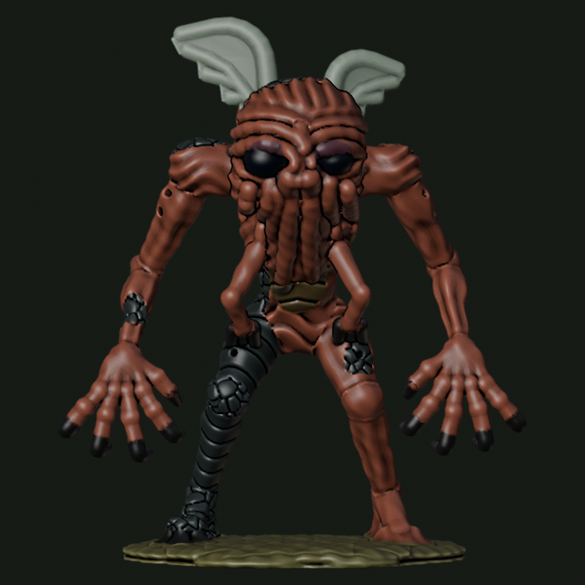

# Brundlefly figurine: printing instructions

This folder holds a 3D model of Brundlefly for printing and for the website, and the scripts that build it.
The shape comes from four views: the front and back views of `assets/brand/character-sheet.png`, and two side views drawn in the same style. The colours come from the front and back views and from side views painted over renders of the shape.



The print model has the stance of the website model: the crouch of `assets/brand/character.png`.
The crouch is lower than the straight stand, and the file is still 80 mm tall. So each part is 3 percent larger than before.
The files of the straight stand are in the git history, at commit `a9fac8c`.

## How the model is made

1. `source/views/front.png` and `source/views/back.png` are the front and back views, cut from the character sheet. The sheet has no side view. `source/views/shape-side-right.png` and `source/views/shape-side-left.png` are side views that an image model drew from the sheet, for the shape only.
2. An image-to-3D model reads the four views and returns a base mesh: `source/hunyuan3d-multiview-shape.glb`.
3. `source/views/side-right.png` and `source/views/side-left.png` colour the sides. An image model painted them over grey renders of the base mesh, so they line up with it. `source/views/front-under.png` is the front view with the mouthparts and the small arms removed. It colours the skin behind those parts.
   - `source/views/premium/` holds a second set for the website model: front, back, both sides, and the front view without mouthparts and small arms. An image model painted them over grey renders of the base mesh, in the realistic style of `assets/brand/kit/lair/mascot-sculpt-reference.png`. The website texture takes its colours from them. `head.png` is a closer painting of the head and the shoulders, at 2.5 times the scale of the front view; `head.json` gives its frame on the working mesh. It replaces the front view where it lies, so the head is sharp in the close shot of a conversation. `head-left.png` and `head-right.png` are paintings of the head from 60 degrees to each side of the front, at the same scale; `head-views.json` gives their frame. They colour the cheeks and the temples. The pixel-art views still place the eyes, trim the smaller wing, and colour the preview of the print model.
4. `build_from_mesh.py` turns the base mesh into the print model and the website model in Blender:
   - It removes the bristle spikes. It keeps the thin wings and mouthparts. A wing membrane takes its original surface back as a whole.
   - For printing, it grows parts that are thinner than 1.6 mm, by up to 0.5 mm on each side.
   - For printing, it then poses the solid into the stance of `source/stance.json`, and it adds the base under the posed feet. The "Rebuild" section gives the steps of the pose.
   - It projects the four views onto the vertex colours. Each surface takes its colour from the views that it faces. The head gets its own image fit, so the face lines up. The wings and the shoulders keep the body fit.
   - It cuts the smaller wing back to its outline in the sheet's front view. The generator makes that wing wider than the sheet draws it.
   - It gives each eye a socket, at the proportions of the site's relief rig: the eye on screen left is about 1.4 times as wide as the other. On the print model each socket holds a globe and two open lids, as part of the solid: half shells that hug the globe above and below. On the website model each socket is empty: the site builds the relief rig's own eye and lids there.
5. `export_model.py` writes the files. For the website model it bakes the four views into a texture, and it adds the skeleton from `source/rig-joints.json`, the skin weights, and an idle clip. It then poses the website model into the stance of `source/stance.json` and makes that pose the rest shape.
6. `validate.ts` checks the print files.

`assets/prompts/figurine.json` records the generator, the date, and the settings.
Read the licence note in that file before you sell prints of this mesh.

## Files

| File | Use |
| --- | --- |
| `brundlefly-80mm.stl` | Print file, 80 mm tall. Send this file first. |
| `brundlefly-100mm.stl` | The same model at 100 mm. Every thin part is 25 percent thicker. |
| `brundlefly.blend` | Editable master. One Blender unit is one millimetre. |
| `brundlefly-preview.glb` | Coloured preview of the print model, with the base. |
| `brundlefly-web.glb` | Model for the website: rigged, in the stance of the character artwork, no base, thin bristle hairs, thin parts not thickened. |
| `source/` | The generated base mesh, the view images for the shape and for the colours, the joint positions for the skeleton, and the stance of the two models. |
| `validation-report.json` | Output of `validate.ts` for the two STL files. |
| `previews/` | Front, side, back, three-quarter, and top renders of the print model, two of the website model, and one pose test of the rig. |

## Dimensions

All values are millimetres. They come from `validation-report.json`.

| File | Width (X) | Depth (Y) | Height (Z) | Volume | Triangles |
| --- | --- | --- | --- | --- | --- |
| `brundlefly-80mm.stl` | 76.42 | 53.09 | 80.00 | 28.49 cm³ | 200,000 |
| `brundlefly-100mm.stl` | 95.52 | 66.37 | 100.00 | 55.64 cm³ | 200,000 |

Height runs from the underside of the base to the tip of the larger wing.
The base is about 3 mm thick at 80 mm. The underside is flat.
The footprint of the base on the bed is 73.5 mm wide and 36.6 mm deep. One long hand reaches about 2 mm past its front edge.
The head reaches about 6 mm past the front of the base, and the larger wing about 7 mm past its back.
The figure faces the front of the base. It does not have the turn of the website model.

## Material

- First choice: tough resin or MJF nylon, if the supplier offers it. Both hold fine claws and folds far better than FDM.
- FDM choice: flexible TPU, Shore 95A. Thin claws and wing edges bend in TPU. They snap in rigid FDM plastic.
- A squeezable feel is not a goal. The model is one solid shell.
- Colour: one colour. Rust or black fit the palette in `docs/arch/brand.md`.

## Print orientation and supports

- Print upright, with the flat base on the bed.
- This pose needs supports. With a 45 degree threshold, the slicer used 19.1 cm³ of support for 15.7 cm³ of model.
- `validation-report.json` lists the points where material starts in mid-air (`mid_air_islands_mm`): 43 at 80 mm.
- The largest groups are the fingers and claws of the two long-arm hands, and the two small-arm hands.
- The hanging mouthparts, the lower edges of the two wings, and the stubs under the lower back are the other groups.
- The two long arms reach forward and out. The lowest fingertip is about 19 mm above the bed.
- The head, the belly, and the wings overhang by more than 45 degrees. The slicer supports them.
- Use tree or organic supports. They touch less surface than grid supports.

## Slicer settings

Sliced values come from PrusaSlicer 2.9.7 with a generic 0.4 mm FDM profile. They are in `validation-report.json`.

| Setting | Value | Source |
| --- | --- | --- |
| Layer height | 0.2 mm | Sliced |
| Nozzle | 0.4 mm | Sliced |
| Walls | 3 | Sliced |
| Infill | 15 percent gyroid | Sliced |
| Filament without supports | 15.7 cm³, 2 h 21 min | Sliced |
| Filament with supports at 45 degrees | 34.7 cm³, 4 h 24 min | Sliced |
| Support filament | 19.1 cm³ | Sliced, by difference |
| Layer height for more detail | 0.12 to 0.16 mm | Estimate |
| TPU nozzle temperature | 220 to 235 °C | Estimate |
| TPU print speed | 20 to 30 mm/s | Estimate |
| Support Z gap for TPU | 0.20 to 0.25 mm | Estimate |
| Brim | 3 to 5 mm | Estimate |

No TPU printer profile was tested. A real print has not been made.

## Thin parts

The print model keeps the proportions of the artwork, so some parts are thin.

- The two wings are about 1.6 mm thick at 80 mm. Each wing is about 2.0 mm or more over its first 3 mm from the body.
- Fingers, claws, small arms, and mouthparts are 1.6 mm or more.
- Each long arm is 3.3 mm or more at its elbow and at its wrist. Each small arm is 2.6 mm or more.
- Each leg is 2.6 mm or more between the foot and the knee. The thinner leg is 2.63 mm there, and the other leg is 2.84 mm.
- Each foot meets the base over about 150 mm²: 159 mm² and 151 mm², in a slice 0.3 mm above the top of the base.
- The voxel check reports 14 mm³ under 1.5 mm in the whole model. Each spot is 2.5 mm³ or smaller. They are the front rim of the base, the edge of the smaller wing, and stubs on the back.
- The check uses 0.25 mm voxels. Read each limit with a tolerance of 0.25 mm.

For a stronger print, use `brundlefly-100mm.stl`: the wings and the fingers are about 2.0 mm.
To thicken further, rebuild with `--min-radius 1.0 --max-growth 0.7`. The figure then looks heavier.

## Likely failure points

- The wings. They are thin and they overhang.
- The two long arms. Each one reaches forward and out, and only the shoulder holds it.
- The two ankles. The crouched figure stands on them, and the thinner leg is 2.6 mm.
- Fingers, claws, and the small arms. Supports attach near them.
- The hanging mouthparts. They are thin and they start in mid-air.
- Support scars under the hands, the chin, and the belly. TPU supports are hard to remove cleanly.
- Stringing between the fingers and between the small arms and the body.

## Checks that ran

`node validate.ts` ran these checks on both STL files after a new import:

- Non-manifold edges, boundary edges, degenerate faces, loose vertices: zero.
- Shells: one. Volume: positive. Self-intersecting face pairs: zero.
- Height: 80.00 mm and 100.00 mm.
- Blender 3D Print Toolbox, check all: zero non-manifold edges, zero intersecting faces, one shell.
- The toolbox also reports 5,723 thin faces and 21,213 overhang faces at 80 mm. The overhang count agrees with the need for supports.
- Mid-air start points: 43 at 80 mm.
- Voxel thickness check at 0.25 mm pitch.
- Stability: the centre of mass is 17.4 mm inside the footprint edge. The solid model tips at about 28 degrees.
- PrusaSlicer slice with supports and without supports.

## Changes for printing after the pose

The print model has the stance of the website model. Three parts of it differ from that model, and each one is for the print.

- The hands and the fingers keep their shape from the base mesh. Each hand turns at the wrist as one piece.
- The site can curl the fingers of the website model. The print model does not take that curl.
- A rigid hand prints better, and the fingers stay separate. With the automatic weights, some fingers tore into thin sheets.
- Each wing is thicker at its root. It grows by 0.35 mm on each side over its first 3 mm from the body.
- That brace adds about 71 mm³ over the two wings. The turn of the wing joint stretches the membrane there, and a printed wing breaks at its root.
- The pose brings the root of the smaller wing against the shoulder beside it. The slot between them was under 1 mm wide.
- A slot under 1 mm does not print clean, and supports cannot leave it. So the build fills that slot with about 6 mm³.
- The smaller wing and that shoulder are one piece there.
- The build fills 15 smaller slots in the same way. All 16 take about 14 mm³.

The volumes are from `build-stats.json`, which the build writes beside its working file. They are at the scale of the 80 mm file.

## Measurements that are not in the report

`validation-report.json` does not hold these values. Each one is from a single measurement outside this folder, on the 80 mm file.

- The distance to the website model: half of its vertices within 0.2 mm, nine tenths within 0.9 mm.
- The thickness of each long arm (3.3 mm), of each small arm (2.6 mm), and of each wing root (2.0 mm).
- The thickness of each leg between the foot and the knee: 2.63 mm and 2.84 mm.
- The area where each foot meets the base: 159 mm² and 151 mm².
- The long hand that reaches about 2 mm past the front edge of the base.

Each section of an arm or a leg lies across the line between two joints. Its thickness is the diameter of the largest circle that fits in it.
On the straight model of commit `a9fac8c`, the same legs are 2.56 mm and 2.76 mm, and the same feet meet the base over 151 mm² and 143 mm².
The reach of the head and of the larger wing past the base is the difference of two values in the report.

## Checks the printer must confirm

These checks did not run:

- A print on a real machine, in any material.
- The printer's own minimum wall and minimum feature limits, above all for the wings.
- Support removal without damage to the fingers, wings, and mouthparts.
- Stability of the printed figure on its base.
- Material, hardness, and colour in stock.

Automated mesh checks are not a print-service approval.

## Bristles

The generated mesh has bristles as thin spikes. The print model removes them, because they are thinner than a nozzle.
The website model replaces each spike with a thin hair, as the sheet draws them. The print model has no holes for bristles.

To add a real fibre after printing:

1. Push a pin or a hot needle 2 to 3 mm into the surface.
2. Cut a stiff fibre 6 to 10 mm long. Brush bristle or 0.3 mm nylon line are good choices.
3. Dip the end in flexible cyanoacrylate glue and push it into the hole.
4. Let the glue cure before you handle the figure.

These steps are untested on a printed part.

## Differences from the brand artwork

- The figure stands on an integrated base. A printed figure on two thin legs does not stand without one.
- One material prints no colour. The print shows shape only.
- The sheet has no side view. An image model drew two side views for the shape, so the side shape follows that drawing and not canonical artwork. The colours of the sides are a second set of generated images, painted over renders of the mesh.
- The print model has no bristles, and its thin parts are a little thicker than in the artwork.
- The artwork shows the figure turned to one side. The print figure has the same stance, and it faces the front of its base.
- Each hand and each foot keeps the shape of the straight stand, and each wing is thicker where it leaves the body.

## Website model

`brundlefly-web.glb` follows the contract that the site loader expects.

- glTF 2.0 binary, metres, Y up. The soles are at height zero.
- The rest shape is the stance of `assets/brand/character.png`, which is also the stance of the site's relief rig. `source/stance.json` holds the stance, and `export_model.py` bakes it in. The print model takes the same stance in its build, without the root turn.
- In this stance the figure is 77.5 mm tall for the 80 mm build. With the root turn it spans -33.9 to 27.4 mm across the view and -25.5 to 25.1 mm in depth.
- Through the relief rig's walk cycle the long hands stay at least 2.4 mm from the legs, and the small hands at least 1.1 mm.
- One root node, `Brundlefly`, with a scale of 0.001 and a turn of 0.5 radians about the vertical, toward screen right. That turn is the three-quarter view of the artwork. The site changes it to turn the figure toward his path.
- Inside the root, the body faces +Z. The head faces the same way, with a roll. The site turns the head to the viewer.
- `Brundlefly-body`: about 66,000 triangles. The head and the shoulders have about 2.4 times the triangles for each square millimetre that the rest has, and their UV islands are 1.6 times larger along each side, for the close shot of a conversation. The count includes about 80 bristle hairs of three triangles each; a hair takes the skin weights of the vertex under it. Texture coordinates in `TEXCOORD_0`, material `Brundlefly-skin`, single sided, roughness 0.42. It has no `COLOR_0`.
- The base colour is one embedded JPEG texture, 2048 pixels square, painted from the views in `source/views/premium/`. On the head and the shoulders, the surfaces that face the front take the closer painting `head.png`. On the skull, a surface that faces more to one side takes `head-left.png` or `head-right.png`, if that painting sees it, with a narrow blend to the front painting. The mouthparts and the rim of each eye stay with the front painting. A surface that a view cannot see, because another part is in front of it, takes the blurred colour of that view, or the colour of `front-under.png` where a mouthpart or a small arm is the part in front. So the body carries no painted copy of a mouthpart or an arm, and a moving part does not leave its picture behind.
- Four corrections go into the base colour at the bake. The mouthparts take the flesh colour of the face around their roots and keep their own light and dark: the painted ones were a pale yellow. Skin that no view sees takes fine detail from one patch of the painted skin, laid on from three sides, so the belly, the inner thighs, and the skin under the chin are not plain. Inside each eye socket the skin grows dark toward the eye, as a shadowed fold and not a black hole. The painted front view has a dark socket at each eye, both as large as the larger one; that dark paint is filled with the skin around it, because the model shades its own sockets at their true sizes.
- A second embedded JPEG, 1024 pixels square, is the normal map of `Brundlefly-skin`. It holds the fine detail of the painting as relief: dark creases lie deep and pale ridges stand up. It has no tangents; a viewer derives them from the texture coordinates.
- A third embedded JPEG, 1024 pixels square, is the surface map of `Brundlefly-skin`: occlusion in red and roughness in green, as glTF packs them. The occlusion is a soft shadow in the folds, and a broad shadow where another part of the body stands close over the skin: under the chin, in the armpits, behind the mouthparts. Both come from the solid shape, as the share of solid near each point, because a ray bake on the decimated mesh gave noise. On average the map is 0.93, and a tenth of the surface is below 0.8. A quarter of it is also in the base colour, so it shows under any light. The roughness makes chitin and claws shine, keeps the wings dull, and makes the skin damp, and wetter in its folds.
- `Brundlefly-body` has two primitives. The second holds the wing membranes, with the material `Brundlefly-wing`: the same textures and the same settings as the skin. The site can light or tint the wings through that material. It has no transmission, because three.js draws the opaque scene a second time each frame for a transmissive material.
- `Brundlefly-eye-0` and `Brundlefly-eye-1`: eye markers, low-polygon spheres, material `Brundlefly-lid`. Eye 0 is on screen left and is the larger eye. The site hides each marker and builds the relief rig's own eye and lids at it. The body mesh has an empty, dark socket behind each marker, and no eyeball or lid of its own.
  - Each marker is a unit sphere centred on its origin. The site reads its translation as the eye centre, its rest rotation, and its X scale as the half width of the globe: 1.49 mm and 1.04 mm. That is 0.116 and 0.081 of the head width, as on the relief rig. The centre sits 0.65 of the depth radius behind the skin, so the rims of the open lids meet the skin. The socket is 1.09 times the globe across and in height and 1.16 times in depth. On the website model the larger eye sits 0.3 of its across radius nearer the nose than the sheet draws it, and 0.2 of its depth radius deeper: with the site's lids it stood out past the outline of the head.
  - `Brundlefly-lid` carries the skin for the lids that the site builds: a white base colour factor and a 256 pixel texture of the head skin just above the eye socket, from the painted front view, blended between its pixels. The site's lids show the middle 44 percent of it. With the relief rig's own darker lid skin, a shut eye stood out from this head. Each marker supplies `TEXCOORD_0` for this texture and has no `COLOR_0`.
- `anchor-face`: an empty node at the front of the face, on the brow, about 6.4 mm above the line of the eyes. The site frames its close shot on the midpoint of the two eye markers.
- No base. `compact_glb.ts` stores normals as bytes, texture coordinates as shorts, and skin weights as bytes, which saves about 0.9 MB. Byte normals need the glTF extension `KHR_mesh_quantization`, and the file lists it as required. three.js reads it with no decoder. Positions stay as floats.
- The site build stops if the file is larger than 4 MiB. The file is 3.50 MB. That limit is the site's own budget for page weight, set in `website/scripts/sync-brand.ts`. A texture of 3072 pixels made the file 5.5 MB and the head only slightly sharper, so the texture stays at 2048.

Skeleton:

- One skin, 58 joints, at most four influences for each vertex. The weights come from Blender's automatic heat weighting.
- Every joint has an identity rest rotation, in the axes of the root: +X is the figure's left side, +Y is up, +Z is the way the body faces.
- Left and right are screen left and screen right. So `left-shoulder` is the figure's right shoulder.
- Body, 25 joints: `pelvis` > `chest` > `head`. From `chest`: `left-shoulder` > `left-elbow` > `left-hand`, `left-rib` > `left-small-elbow` > `left-small-hand`, `left-wing` > `left-wing-tip`, and the same on the right. From `pelvis`: `left-hip` > `left-knee` > `left-foot`, and the same on the right.
- Face, 5 joints under `head`, with the names of the relief rig: `face-jaw`, `face-cheek-left`, `face-cheek-right`, `face-brow-0`, `face-brow-1`. Their weights are smooth patches on the front of the face: the jaw below the eyes, a cheek beside each eye, and a brow above each eye. The eye sockets stay rigid on `head`.
- Face tentacles, 8 joints under `face-jaw`: `mouthpart-0` to `mouthpart-3`, from screen left to screen right, each with a `-tip` joint. Each one is a firm, jointed rod: its skin follows its own two joints only, with a short blend at the root and at the middle joint. So a swing moves the tentacle and does not stretch the skin of the face.
- The eye markers and `anchor-face` are children of the `head` joint. The skin around each eye socket has `head` as its only joint, so the socket does not slide past the eye in a pose.
- One clip, `Brundlefly-idle`, 4 seconds, made to loop: breathing, a small head turn, twitching small arms, swaying tentacles, fluttering wings.
- Fingers, 20 joints: `left-finger-0` to `left-finger-4` under `left-hand`, each with a `-tip` joint, and the same on the right. The number runs across the hand. The export finds each finger in the mesh, as a piece of skin past the knuckle line, and gives it a joint at its base and one at its middle. The rest shape does not change. The root node `Brundlefly` has `extras.finger_hinges`: for each finger joint, the unit axis to turn it about, in the joint's own axes. A positive turn curls the finger toward the palm, and a negative turn opens it. I rendered a curl of 0.5 and 0.6 radians and an opening of -0.35 and -0.3 radians.
- The toes and the fingers of the small hands have no joints.

`previews/web-pose-test.png` shows a strong test pose through this rig, from the straight stand. `previews/web-front.png` and `previews/web-three-quarter.png` show the rest shape with the root turn, and with the head turned to the viewer as the site does.

## Rebuild

Blender 5.3 as a Flatpak, PrusaSlicer as a Flatpak, Node 24, and `uv` are necessary. Use absolute paths.
The Flatpak apps reach the home folder only. Put `OUT` under your home folder.

```bash
D=/abs/path/to/assets/3d/brundlefly
OUT=$HOME/scratch/brundlefly-build
V=$D/source/views
VIEWS="--front-image $V/front.png --back-image $V/back.png --right-image $V/side-right.png --left-image $V/side-left.png"
flatpak run org.blender.Blender -b --factory-startup --python $D/build_from_mesh.py -- --source $D/source/hunyuan3d-multiview-shape.glb --out $OUT $VIEWS --stance $D/source/stance.json
flatpak run org.blender.Blender -b --factory-startup --python $D/export_model.py -- --blend $OUT/brundlefly-work.blend --out $D --tris 200000 --glb-tris 120000
flatpak run org.blender.Blender -b --factory-startup --python $D/render_previews.py -- --blend $D/brundlefly.blend --out $OUT/previews --modes colour --views front,three-quarter,side,back,top
node $D/validate.ts
```

The renders are named `<view>-colour.png`. Copy them to `previews/<view>.png`.

For the website model, leave out `--stance`, add `--variant web --paint-dir $V/premium` to the build, and add `--web --glb-tris 66000 --texture-size 2048 --relief-size 1024 --image-quality 80` to the export. The export reads `source/rig-joints.json`. Those joint positions fit this base mesh only. Measure them again if the base mesh changes. The frames in `source/views/premium/head.json` and `head-views.json` also fit this base mesh only. Then run `node $D/compact_glb.ts <exported file> $D/brundlefly-web.glb`. The export reads `field.npz` from the build folder for the fold shadow, so the build needs `--dump-field`.

`--stance` gives the print model the stance of the website model. Without the flag, the build makes the straight stand of commit `a9fac8c`.
A check outside this folder compared the two surfaces, with the root turn of the website model removed. Half of the website model's vertices are within 0.2 mm of the print figure. Nine tenths are within 0.9 mm.

- The build poses the solid after it grows the thin parts, and before it adds the base and the eyes. The steps before the pose read the sheet views, and those views show the straight stand.
- The build binds the dense surface to the skeleton of `source/rig-joints.json` and turns the joints as `export_model.py` does for the website model. The posed surface becomes the solid again. The skin weights come from a copy of 66,000 triangles.
- The turn of the whole body in `stance.json` is left out. The figure faces the front of its base.
- Each hand, small hand, and foot stays in one piece, and the skin of the body does not follow a wing. The automatic weights tear a finger and leave a ragged step on the back when the solid is posed.
- After the pose, thin parts grow once more. The turn of a wing joint stretches the membrane at its root. So each wing also grows by 0.35 mm on each side over its first 3 mm. Then each slot that the pose made narrower than 1.2 mm is filled. A slot under 1 mm does not print clean.
- The base lies under the new footprint. The globe and the lids of each eye take the turn of the head joint.
- The posed figure is lower than the straight one, and the file is still 80 mm tall. So each part is 3 percent larger than on the straight model.
- `build-stats.json` records the pose under `stance`: the fit of the joints, the stretch of the skin, the height of each sole, and each slot filled.
- The colours of the preview follow the skin through the pose.

`build_model.py` holds the field library that `build_from_mesh.py` uses. It also holds a first, script-built figure, which is retired.

The scripts are Python where Blender, trimesh, or scipy make it necessary. The check runner is TypeScript.

## Quote request

> Subject: Quote request: 80 mm character figurine, delivery to Melbourne by 26 November
>
> Hi,
>
> I need a small character figurine printed and delivered to Melbourne by Thursday 26 November 2026.
>
> - Part: one-piece figurine with an integrated base. The STL is attached.
> - Size: 76 × 53 × 80 mm. Volume 28.5 cm³.
> - Quantity: 1. Please also price 3 units, and the 100 mm version (96 × 66 × 100 mm, 55.6 cm³).
> - The thinnest parts are the two wings, the fingers, and the claws, at about 1.6 mm. The two long arms reach forward. The hands and the head need supports.
>
> Could you tell me:
>
> 1. Which process and material you recommend for this level of detail: tough resin, MJF nylon, or flexible TPU.
> 2. Your minimum wall thickness and minimum feature size for that material.
> 3. If the wings and fingers need to be thicker for your process.
> 4. Which colours are available.
> 5. Your lead time, and the order cutoff for delivery by 26 November.
> 6. Shipping cost to Melbourne, or pickup options.
>
> Thanks,
> Harlan
