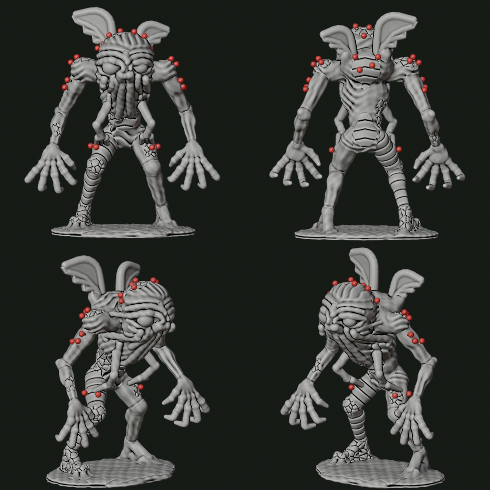

# Brundlefly figurine: printing instructions

This folder holds a printable 3D model of Brundlefly and the scripts that build it.
The pose is the standing, hunched pose of `assets/brand/character.png`.


## Files

| File | Use |
| --- | --- |
| `brundlefly-80mm.stl` | Print file, 80 mm tall. Send this file first. |
| `brundlefly-100mm.stl` | The same model at 100 mm. Every thin part is 25 percent thicker. |
| `brundlefly.blend` | Editable master. One Blender unit is one millimetre. |
| `brundlefly-preview.glb` | Coloured preview of the print model, with the base. |
| `brundlefly-web.glb` | Coloured model for the website: no base, no bristle dimples, thinner fingers and claws. |
| `bristle-map.json`, `previews/bristle-map.png` | Position and direction of each bristle dimple. |
| `validation-report.json` | Output of `validate.ts` for the two STL files. |
| `previews/` | Front, side, back, three-quarter, and top renders. |

## Dimensions

All values are millimetres. They come from `validation-report.json`.

| File | Width (X) | Depth (Y) | Height (Z) | Volume | Triangles |
| --- | --- | --- | --- | --- | --- |
| `brundlefly-80mm.stl` | 69.20 | 45.64 | 80.00 | 20.09 cm³ | 197,000 |
| `brundlefly-100mm.stl` | 86.50 | 57.05 | 100.00 | 39.23 cm³ | 197,000 |

Height runs from the underside of the base to the tip of the larger wing.
The base is about 2.3 mm thick at 80 mm. The underside is flat.

## Material

- First choice: flexible TPU, Shore 95A, FDM. Thin claws and wing edges bend in TPU. They snap in rigid plastic.
- A squeezable feel is not a goal. The model is one solid shell.
- Alternative: PLA or PETG. The print is easier, but claws and fingers break more easily.
- Alternative: resin. It gives the best surface detail at this size. Standard resin is brittle, so ask for a tough resin.
- Colour: one colour. Rust or black fit the palette in `docs/arch/brand.md`.

## Print orientation and supports

- Print upright, with the flat base on the bed.
- This pose needs supports. With a 45 degree threshold, the slicer used 17.3 cm³ of support for 13.2 cm³ of model.
- `validation-report.json` lists 30 points where material starts in mid-air (`mid_air_islands_mm`).
- Ten of these points are the claws and thumbs of the two long-arm hands, 15 to 24 mm above the bed. They need supports from the bed.
- The other points are small: mouthpart tips, the undersides of the shoulders, the wing root, and plate edges on the chitin leg.
- The head, the chest, and the lower wing edges overhang by more than 45 degrees. The slicer supports them.
- Use tree or organic supports. They touch less surface than grid supports.
- The mouthparts lie on the chest, and the small-arm claws touch the thighs. This keeps them attached along their length.

## Slicer settings

Sliced values come from PrusaSlicer 2.9.7 with a generic 0.4 mm FDM profile. They are in `validation-report.json`.

| Setting | Value | Source |
| --- | --- | --- |
| Layer height | 0.2 mm | Sliced |
| Nozzle | 0.4 mm | Sliced |
| Walls | 3 | Sliced |
| Infill | 15 percent gyroid | Sliced |
| Filament without supports | 13.2 cm³, 2 h 16 min | Sliced |
| Filament with supports at 45 degrees | 30.5 cm³, 4 h 10 min | Sliced |
| Support filament | 17.3 cm³ | Sliced, by difference |
| Layer height for more detail | 0.12 to 0.16 mm | Estimate |
| TPU nozzle temperature | 220 to 235 °C | Estimate |
| TPU print speed | 20 to 30 mm/s | Estimate |
| Support Z gap for TPU | 0.20 to 0.25 mm | Estimate |
| Brim | 3 to 5 mm | Estimate |

No TPU printer profile was tested. A real TPU print has not been made.

## Minimum feature sizes

The model follows these limits at 80 mm.

| Feature | Design size |
| --- | --- |
| Fingers and small arms | 2.5 mm diameter |
| Claw tips | 1.5 mm diameter |
| Wing membrane | 2.0 mm thick |
| Grooves between folds and plates | About 0.5 mm deep |

The voxel thickness check found these thin regions in `brundlefly-80mm.stl`:

- Thinner than 1.5 mm: 3.6 mm³ in total. The largest spot is 2.6 mm³ on the left shoulder.
- Thinner than 2.5 mm: the rim of the base, the small-arm claws, the eyelids, and the wing edges. This is by design.
- The check uses 0.25 mm voxels. Read each limit with a tolerance of 0.25 mm.

## Likely failure points

- Claw tips and fingers. They are the thinnest parts, and supports attach near them.
- Support scars under the hands and under the chin. TPU supports are hard to remove cleanly.
- Stringing between the fingers and between the arms and the body.
- The lower edges of the wings. They overhang at about 50 degrees.
- Fine relief. Grooves are about 0.5 mm deep. A 0.4 mm nozzle softens them.

If a print fails at the hands, print `brundlefly-100mm.stl`.

## Checks that ran

`node validate.ts` ran these checks on both STL files after a new import:

- Non-manifold edges, boundary edges, degenerate faces, loose vertices: zero.
- Shells: one. Volume: positive. Self-intersecting face pairs: zero.
- Height: 80.00 mm and 100.00 mm.
- Blender 3D Print Toolbox, check all: zero non-manifold edges, zero intersecting faces, one shell.
- The toolbox also reports 10,308 thin faces and 19,416 overhang faces at 80 mm. Its thin test fires on every convex edge and groove, so the voxel check is the thickness result. The overhang count agrees with the need for supports.
- Mid-air start points: 30 at 80 mm.
- Voxel thickness check at 0.25 mm pitch.
- Stability: the centre of mass is 12.3 mm inside the footprint edge. The solid model tips at about 17 degrees.
- PrusaSlicer slice with supports and without supports.

## Checks the printer must confirm

These checks did not run:

- A print on a real machine, in TPU or in any other material.
- The printer's own minimum wall and minimum feature limits.
- Support removal on TPU without damage to the claws.
- Stability of the printed figure on its base.
- Shore hardness and colour of the stocked filament.

Automated mesh checks are not a print-service approval.

## Bristles

The model has no printed bristles. It has 29 pilot dimples for fibres that you implant by hand.



- Each dimple is about 1.2 mm wide and 2 mm deep. A 0.4 mm nozzle prints it as a small pit.
- The dimples are on the head, the shoulders, the upper back, the upper arms, the thighs, and the chest sides.
- `bristle-map.json` gives each position in millimetres and the direction that points out of the surface.

To implant a fibre:

1. Open the dimple with a 0.8 mm pin vise drill or a hot needle. Go 2 to 3 mm deep.
2. Cut a stiff fibre 6 to 10 mm long. Brush bristle or 0.3 mm nylon line are good choices.
3. Dip the end in flexible cyanoacrylate glue and push it into the hole.
4. Let the glue cure before you handle the figure.

These steps are untested on a printed part.

## Differences from the brand artwork

- The figure stands on an integrated base. Soft TPU on two thin legs does not stand without one.
- One material prints no colour. Chitin is a cell pattern, the back and belly are segmented plates, and flesh is folds.
- Fingers and claws are thicker than in the artwork. `brundlefly-web.glb` keeps the thinner proportions.
- The model is built by a script. It is a stylised reading of the character sheet, not a hand sculpt.

## Rebuild

Blender 5.3 as a Flatpak, PrusaSlicer as a Flatpak, Node 24, and `uv` are necessary. Use absolute paths.

The Flatpak apps reach the home folder only. Put `OUT` under your home folder.

```bash
D=/abs/path/to/assets/3d/brundlefly
OUT=$HOME/scratch/brundlefly-build
flatpak run org.blender.Blender -b --factory-startup --python $D/build_model.py -- --out $OUT --voxel 0.2
flatpak run org.blender.Blender -b --factory-startup --python $D/export_model.py -- --blend $OUT/brundlefly-work.blend --out $D --tris 200000 --glb-tris 120000
cp $OUT/bristle-map.json $D/
flatpak run org.blender.Blender -b --factory-startup --python $D/render_previews.py -- --blend $D/brundlefly.blend --out $OUT/previews --modes colour --views front,three-quarter,side,back,top
flatpak run org.blender.Blender -b --factory-startup --python $D/render_previews.py -- --blend $D/brundlefly.blend --out $OUT/bristles --modes bristles --views front,back,three-quarter,three-quarter-left --bristles $D/bristle-map.json
node $D/validate.ts
```

The renders are named `<view>-colour.png`. Copy them to `previews/<view>.png`. Copy `bristles/sheet-bristles.png` to `previews/bristle-map.png`.

For the website model, add `--variant web` to the build and `--web --glb-tris 90000` to the export.

The scripts are Python where Blender, trimesh, or scipy make it necessary. The check runner is TypeScript.

## Quote request

> Subject: Quote request: flexible TPU figurine, 80 mm, delivery to Melbourne by 26 November
>
> Hi,
>
> I need a flexible figurine printed and delivered to Melbourne by Thursday 26 November 2026.
>
> - Part: one-piece character figurine with an integrated base. The STL is attached.
> - Size: 69 × 46 × 80 mm. Volume 20.1 cm³.
> - Quantity: 1. Please also price 3 units, and the 100 mm version (87 × 57 × 100 mm, 39.2 cm³).
> - Material: flexible TPU. Shore 95A is fine.
> - The thinnest parts are claw tips at 1.5 mm and fingers at 2.5 mm. The hands need supports.
>
> Could you tell me:
>
> 1. Which flexible materials and processes you offer, and their Shore hardness.
> 2. Your minimum wall thickness and minimum feature size for that material.
> 3. If you recommend a different material for fine claws and wings at this size.
> 4. Which colours are available.
> 5. Your lead time, and the order cutoff for delivery by 26 November.
> 6. Shipping cost to Melbourne, or pickup options.
>
> Thanks,
> Harlan
